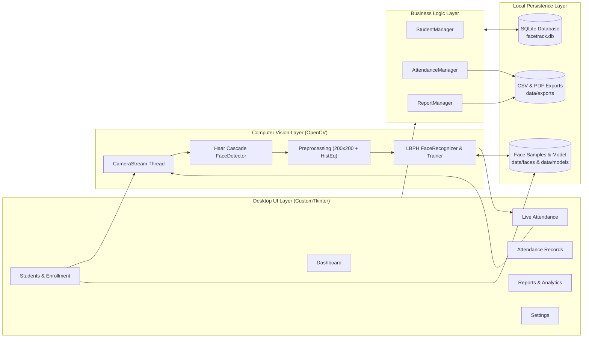

# FaceTrack – Smart Face Recognition Attendance Management System
## College Computer Vision Project Report

---

### 1. Abstract

Attendance management is an essential administrative task across educational institutions. Conventional approaches—manual roll calls, paper registers, or swipe cards—consume valuable instructional time, allow proxy attendance, and require tedious manual compilation for academic reporting. **FaceTrack** presents an offline, desktop-based **Smart Face Recognition Attendance Management System** developed in Python. The system combines **OpenCV's Viola–Jones Haar Cascade Classifier** for real-time frontal face localization and the **Local Binary Patterns Histograms (LBPH)** algorithm (`cv2.face.LBPHFaceRecognizer`) for texture-based facial identification. Recognized students are verified against a configurable confidence distance threshold across consecutive video frames and logged into a persistent **SQLite** relational database enforcing a database-level uniqueness constraint (`student_id + attendance_date`) to prevent duplicate daily entries. Built with a clean **CustomTkinter** desktop user interface and integrated **Matplotlib** and **ReportLab** analytics, FaceTrack provides student registration, guided face enrollment with blur and illumination checks, live camera attendance, manual attendance fallback, record auditing, and CSV/PDF reporting—all operating 100% offline.

---

### 2. Introduction

In universities and colleges, student attendance directly affects academic performance tracking and examination eligibility. As class sizes grow, manual attendance becomes a bottleneck. Biometric identification—specifically **computer vision-based facial recognition**—offers a contactless, rapid, and verifiable alternative. Unlike fingerprint scanners that require physical contact and dedicated hardware queues, a camera-based system can detect and recognize students naturally using an ordinary laptop or classroom webcam.

**FaceTrack** is engineered as a complete, standalone desktop application that transforms any standard Windows laptop into an intelligent attendance station.

---

### 3. Problem Definition

1. **Time Overhead:** Calling 60–100 roll numbers at the start of every lecture wastes 5–10 minutes per class.
2. **Proxy Attendance:** Paper sign-in sheets and verbal roll calls are easily manipulated by students answering for absent peers.
3. **Fragmented Records:** Paper sheets must be manually transcribed into spreadsheets, introducing transcription errors and delaying monthly shortage reports.
4. **Cloud & Dependency Barriers:** Many modern face recognition prototypes rely on paid cloud APIs or heavy C++/CUDA compilation (`dlib`), making them impractical for offline college classrooms.

---

### 4. Existing System

| Method | Drawbacks |
| :--- | :--- |
| **Manual Roll Call / Paper Register** | Slow, prone to proxy attendance, manual calculation of percentages. |
| **RFID / ID Card Swiping** | Students can hand their ID card to a friend; cards get lost or damaged. |
| **Fingerprint Biometrics** | Requires specialized hardware, physical contact hygiene concerns, slow one-by-one queue. |
| **Cloud Face APIs** | Requires constant internet connectivity, incurs per-request costs, raises privacy concerns by uploading student faces to third-party servers. |

---

### 5. Proposed System

**FaceTrack** overcomes these limitations through:
- **Contactless Real-Time Recognition:** Uses the laptop webcam to detect and identify faces at ~25–30 FPS.
- **100% Offline Execution:** All face samples, the trained LBPH model (`lbph_model.yml`), and the SQLite database (`facetrack.db`) stay on the local machine.
- **Quality-Controlled Enrollment:** Captures 15 grayscale 200×200 face samples per student while automatically rejecting blurry frames, extreme lighting, or multi-person frames, and requires explicit student consent.
- **Two-Layer Duplicate Prevention:** Checks existing daily attendance in application logic and enforces a `UNIQUE(student_id, attendance_date)` constraint in SQLite, paired with a configurable notification cooldown.
- **Integrated Analytics & Exports:** Real-time dashboard metrics, 7-day trend charts, department comparisons, and one-click CSV and PDF exports.

---

### 6. System Architecture

---

### 7. Software and Hardware Requirements

#### Hardware Requirements
- **Processor:** Intel Core i3 / AMD Ryzen 3 or higher (dual-core 2.0 GHz+)
- **Memory (RAM):** 4 GB minimum (8 GB recommended)
- **Storage:** 250 MB free disk space for application, database, and face samples
- **Camera:** Integrated 720p laptop webcam or external USB webcam
- **Display:** 1366×768 or higher resolution

#### Software Requirements
- **Operating System:** Windows 10 / Windows 11 (64-bit)
- **Python Version:** Python 3.12
- **Libraries:**
  - `opencv-contrib-python` (4.10.0.84) — Haar Cascades & `cv2.face.LBPHFaceRecognizer`
  - `customtkinter` (5.2.2) — Modern desktop UI widgets
  - `Pillow` — Image processing and Tkinter frame rendering
  - `matplotlib` — Embedded statistical charts
  - `reportlab` — PDF report generation
  - `sqlite3` & `csv` — Built-in Python standard libraries

---

### 8. Methodology

The system operates in four phases:
1. **Student Registration:** Administrative details (Roll Number, Full Name, Department, Course, Email, Phone) are validated via regular expressions and stored in the `students` table.
2. **Face Sample Enrollment & Model Training:**
   - The webcam opens in a background worker thread.
   - Each frame is converted to grayscale and passed to the Haar Cascade detector.
   - If exactly one face of sufficient size (`≥120×120` px), sharpness (Laplacian variance `≥25`), and balanced illumination (`45 ≤ mean ≤ 215`) is detected, the face is cropped, resized to `200×200`, histogram-equalized, and saved to `data/faces/<student_pk>/`.
   - Once 15 samples across varied expressions/angles are collected, `trainer.train_model()` trains the LBPH model and atomically writes `data/models/lbph_model.yml`.
3. **Live Recognition & Attendance Logging:**
   - Frames from the webcam are scanned for faces.
   - Each detected face is preprocessed identically (`200×200` + `cv2.equalizeHist`) and passed to `LBPHFaceRecognizer.predict()`.
   - If the returned chi-square distance is `≤ threshold` (default `50`) for `N` consecutive frames (default `3`), the student is verified and `AttendanceManager.mark()` inserts a row for today's date.
4. **Auditing & Reporting:** Administrators filter records, inspect student histories, make manual corrections if needed, and export CSV or PDF summaries.

---

### 9. Computer Vision Concepts Used

1. **Grayscale Conversion (`cv2.cvtColor`):** Reduces 3-channel BGR color images `(H, W, 3)` to single-channel luminance intensity `(H, W)`, cutting computation by 3× while preserving structural facial features.
2. **Histogram Equalization (`cv2.equalizeHist`):** Spreads pixel intensity values across the full `0–255` range so that faces captured under dim or uneven classroom lighting have consistent contrast during both training and live recognition.
3. **Laplacian Blur Detection (`cv2.Laplacian(...).var()`):** Measures the variance of second-order spatial derivatives (edges). Low variance indicates motion blur; Enrollment automatically skips blurry frames.
4. **Image Pyramids (`scaleFactor=1.15`):** Enables multi-scale face detection regardless of whether the student sits slightly closer or farther from the webcam.

---

### 10. Face Detection Explanation (Viola–Jones Haar Cascade)

Face detection answers **"Where is a face in this frame?"** and returns bounding boxes `(x, y, w, h)`.
- **Haar-like Features:** Rectangular contrast patterns—such as the eye region being darker than the upper cheeks and nose bridge—are evaluated across the image.
- **Integral Image:** Allows any rectangular sum of pixels to be computed in constant $O(1)$ time using four array lookups.
- **AdaBoost Feature Selection:** Selects the most discriminative Haar features from thousands of candidates.
- **Attentional Cascade:** Organizes classifiers into stages of increasing complexity. Background regions fail in the first 1–2 stages and are discarded immediately, focusing computation on promising face regions and achieving real-time speed on a CPU.

---

### 11. LBPH Face Recognition Explanation

Face recognition answers **"Whose face is inside this bounding box?"**

1. **Local Binary Pattern (LBP) Operator:**
   For every interior pixel with intensity $g_c$, LBPH compares it against its 8 surrounding neighbors $g_0, g_1, \dots, g_7$ on a circle of radius $R = 1$:
   $$\text{LBP}(x_c, y_c) = \sum_{p=0}^{7} s(g_p - g_c) \, 2^p, \qquad s(z) = \begin{cases} 1 & \text{if } z \ge 0 \\ 0 & \text{if } z < 0 \end{cases}$$
   This produces an 8-bit binary number (`0–255`) invariant to monotonic grayscale lighting changes because it depends only on relative pixel ordering, not raw brightness.
2. **Spatial Grid Histograms (`8 × 8` Grid):**
   The `200×200` LBP image is divided into $8 \times 8 = 64$ cells. A 256-bin histogram of LBP codes is computed inside each cell, preserving spatial layout (eyes at the top, mouth at the bottom).
3. **Feature Vector Concatenation:**
   The 64 regional histograms are concatenated into one feature vector of $64 \times 256 = 16,384$ values per training sample.
4. **Chi-Square Histogram Distance Matching:**
   When a live face arrives, its histogram $S$ is compared against every stored training histogram $M$ using the Chi-Square ($\chi^2$) distance:
   $$D(S, M) = \sum_{i} \frac{(S_i - M_i)^2}{S_i + M_i}$$
   - **Lower distance $D$ = higher similarity** ($D = 0$ for an identical image).
   - If $D \le \text{threshold}$ (default `50`), the student is recognized; if $D > \text{threshold}$, the face is rejected as **UNKNOWN**.

---

### 12. Database Design

FaceTrack uses SQLite (`database/schema.sql`) with referential integrity enabled (`PRAGMA foreign_keys = ON`).

#### Table 1: `students`
| Column | Type | Constraints | Description |
| :--- | :--- | :--- | :--- |
| `id` | `INTEGER` | `PRIMARY KEY AUTOINCREMENT` | Internal numeric key (also used as the LBPH integer label) |
| `student_id` | `TEXT` | `NOT NULL UNIQUE` | Institutional Roll Number / Student ID |
| `full_name` | `TEXT` | `NOT NULL` | Student's full name |
| `department` | `TEXT` | `NOT NULL` | Academic department |
| `course` | `TEXT` | `NOT NULL` | Course / class / semester |
| `email` | `TEXT` | Nullable | Optional email address |
| `phone` | `TEXT` | Nullable | Optional contact number |
| `photo_path` | `TEXT` | Nullable | Path to profile photo (`data/photos/<id>.jpg`) |
| `face_enrolled` | `INTEGER` | `NOT NULL DEFAULT 0 CHECK (0,1)` | Whether usable face samples are enrolled |
| `created_at` | `TEXT` | `DEFAULT datetime('now','localtime')` | Registration timestamp |

#### Table 2: `attendance`
| Column | Type | Constraints | Description |
| :--- | :--- | :--- | :--- |
| `id` | `INTEGER` | `PRIMARY KEY AUTOINCREMENT` | Attendance record ID |
| `student_id` | `INTEGER` | `NOT NULL FK -> students(id) ON DELETE CASCADE` | Reference to student |
| `attendance_date` | `TEXT` | `NOT NULL` | Date in `YYYY-MM-DD` format |
| `check_in_time` | `TEXT` | Nullable | Check-in time in `HH:MM:SS` format |
| `status` | `TEXT` | `CHECK ('Present','Late','Absent')` | Attendance status |
| `recognition_method`| `TEXT` | `CHECK ('Face','Manual')` | How the record was created |
| `confidence` | `REAL` | Nullable | LBPH chi-square distance (for Face records) |
| **Composite Key** | — | **`UNIQUE (student_id, attendance_date)`** | **Guarantees at most one record per student per day** |

#### Table 3: `settings`
| Column | Type | Constraints | Description |
| :--- | :--- | :--- | :--- |
| `setting_key` | `TEXT` | `PRIMARY KEY` | Configuration key (`camera_index`, `recognition_threshold`, etc.) |
| `setting_value` | `TEXT` | Nullable | Stored string value |

---

### 13. Module Descriptions

- **`config.py`**: Centralizes directory paths, default settings, logging configuration, and UI design tokens.
- **`database/db_manager.py`**: Thread-safe SQLite wrapper using context managers, parameterized queries, online SQLite backup (`sqlite3.Connection.backup`), and integrity-checked restore.
- **`recognition/face_detector.py`**: Loads the Haar Cascade XML, detects faces sorted by area, crops/equalizes `200×200` faces, computes Laplacian sharpness, and draws corner-accented overlays.
- **`recognition/face_recognizer.py` & `trainer.py`**: Manages LBPH training (`train_model`) with atomic file replacement and thread-safe prediction (`FaceRecognizer`).
- **`recognition/camera.py`**: Runs `cv2.VideoCapture` in a daemon thread (`CameraStream`) so camera I/O never blocks the Tkinter event loop.
- **`recognition/enrollment.py` & `live_engine.py`**: Implements quality-gated sample capture (`EnrollmentSession`) and multi-frame streak verification + cooldown (`LiveRecognitionEngine`).
- **`modules/student_manager.py`, `attendance_manager.py`, `report_manager.py`**: Encapsulate validation, CRUD, duplicate prevention, date-range aggregations, CSV exports, and ReportLab PDF generation.
- **`ui/*`**: Modular CustomTkinter views (`main_window.py`, `dashboard.py`, `live_attendance.py`, `students.py`, `attendance_records.py`, `reports.py`, `settings.py`, `components.py`, `charts.py`, `video.py`).

---

### 14. Testing

FaceTrack includes two automated test suites in `tests/`:
1. **`tests/test_backend.py` (14 test cases):**
   - Verifies schema creation and default settings initialization.
   - Tests student input validation (invalid roll numbers, short names, malformed emails/phones, duplicate roll numbers).
   - Verifies two-layer duplicate attendance prevention (application check + SQLite `IntegrityError` on `UNIQUE(student_id, attendance_date)`).
   - Tests attendance filtering, unmarked-absent synthesis, late cutoff rules, record correction, deletion, and CSV/PDF export headers.
   - Tests SQLite backup and restore with rollback verification and corrupt-file rejection.
   - Tests missing and corrupt LBPH model handling.
   - **Real-Face LBPH Evaluation (Olivetti Faces benchmark):** Trained on 20 real subjects (140 images) and tested on 60 held-out images + 200 unknown stranger images, achieving **91.7% rank-1 identification accuracy** and verifying that low-confidence matches are rejected.
2. **`tests/test_ui_integration.py`:**
   - Instantiates the full CustomTkinter `App`, programmatically exercises Dashboard, Students, Live Attendance, Attendance Records, all 5 Reports tabs, and Settings, and verifies clean shutdown.

---

### 15. Advantages

- **Completely Offline & Privacy-Respecting:** No student images or attendance logs ever leave the local computer.
- **No GPU or Complex Compilation Required:** Runs smoothly on standard college laptops using CPU-only OpenCV.
- **Zero Proxy Attendance in Supervised Use:** Requires the enrolled student's face in front of the camera and enforces one entry per day.
- **Resilient Design:** Continues working via Manual Attendance even if a webcam is unplugged or unavailable.

---

### 16. Limitations

- **Lighting & Pose Constraints:** Extreme shadows or head turns beyond ~25° reduce Haar Cascade recall.
- **Single-Camera 2D Input:** Without an infrared or depth sensor, basic 2D LBPH cannot inherently distinguish a high-resolution photograph from a live face without operator supervision.
- **Full Retraining on Enrollment:** When a new student is enrolled, the LBPH histograms are rebuilt from all `data/faces/` folders (fast for hundreds of students—under 1 second—but scales linearly with total samples).

---

### 17. Future Scope

1. **Blink / Challenge–Response Liveness Detection:** Require a natural eye blink or head nod using facial landmarks before marking attendance.
2. **Multi-Period Timetable Support:** Allow attendance per lecture slot/subject code rather than once per calendar day.
3. **Deep Metric Embeddings (SFace / ArcFace ONNX):** Optional toggle between lightweight LBPH and ONNX deep embeddings for large multi-thousand-student campuses.
4. **Automated Parent/Student Notifications:** Local SMTP or WhatsApp gateway integration for monthly attendance summaries.

---

### 18. Conclusion

**FaceTrack** demonstrates how classical, interpretable computer vision algorithms—**Viola–Jones Haar Cascades** and **Local Binary Patterns Histograms (LBPH)**—combined with a disciplined **SQLite** database design and a responsive **CustomTkinter** interface, can solve a real institutional problem reliably. The system fulfills all functional and non-functional requirements: accurate real-time recognition, strict duplicate prevention, graceful error recovery, and comprehensive analytics ready for immediate classroom deployment and academic evaluation.
