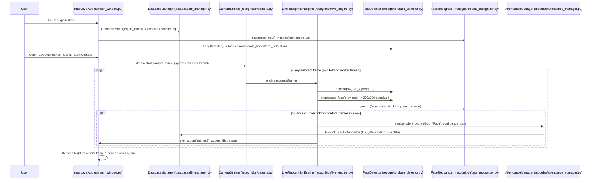

# FaceTrack – Technical Documentation

This document explains every Python file in **FaceTrack**, its responsibilities, key classes and functions, and how the modules interact at runtime.

---

## 1. High-Level Runtime Flow

---

## 2. File-by-File Reference

### Root Files

#### `main.py`
- **Role:** Application entry point.
- **What it does:**
  1. Sets `MPLCONFIGDIR` to a local writable folder (`data/.mplcache`) so Matplotlib never stalls building font caches.
  2. Calls `config.ensure_directories()` and `config.setup_logging()` to initialize rotating file logs at `data/logs/facetrack.log`.
  3. Initializes `DatabaseManager(config.DB_PATH)`. If the database file cannot be opened, displays a user-friendly error dialog instead of a traceback.
  4. Starts the `App` (`ui/main_window.py`) main event loop.

#### `config.py`
- **Role:** Single source of truth for paths, constants, default settings, and UI colors/fonts.
- **Key Constants:**
  - `FACE_SIZE = (200, 200)` — Standardized resolution for all stored and queried face images.
  - `DEFAULT_SETTINGS` — Default camera index (`0`), LBPH threshold (`50`), cooldown (`5` seconds), sample count (`15`), confirmation frames (`3`), and optional late cutoff (`late_after`).
  - `COLORS` — Cohesive warm off-white (`#F6F3EE`), charcoal-navy sidebar (`#1F2733`), white card surfaces (`#FFFFFF`), and muted terracotta accent (`#C2603A`) palette.

---

### `database/` Package

#### `database/schema.sql`
- Defines the three SQLite tables (`students`, `attendance`, `settings`), foreign-key cascade rules (`ON DELETE CASCADE`), and performance indexes (`idx_students_department`, `idx_attendance_date`, `idx_attendance_student`).
- Enforces `UNIQUE (student_id, attendance_date)` on the `attendance` table.

#### `database/db_manager.py` — `DatabaseManager`
- **`connect()`**: Context manager that opens a SQLite connection with a 10-second lock timeout, sets `sqlite3.Row` factory, enables `PRAGMA foreign_keys = ON`, commits on success, rolls back on exception, and closes the connection. Opening a short-lived connection per operation makes `DatabaseManager` safe to call from both the Tkinter UI thread and the background camera worker thread.
- **`fetch_all()`, `fetch_one()`, `execute()`**: Parameterized query helpers using `?` placeholders to prevent SQL injection.
- **`get_setting()`, `set_setting()`**: Reads/writes persistent application settings using `INSERT ... ON CONFLICT(setting_key) DO UPDATE`.
- **`backup()` & `restore()`**: Uses SQLite's online backup API (`sqlite3.Connection.backup`). Before restoring any backup file, `restore()` opens the candidate file in read-only mode, verifies that `students`, `attendance`, and `settings` tables exist, runs `PRAGMA integrity_check`, and creates an automatic safety backup of the current database.

---

### `recognition/` Package

#### `recognition/face_detector.py` — `FaceDetector`
- Loads `assets/haarcascades/haarcascade_frontalface_default.xml` (with fallback to `cv2.data.haarcascades`).
- **`detect(gray, min_size)`**: Equalizes the grayscale frame (`cv2.equalizeHist`) and calls `cascade.detectMultiScale(scaleFactor=1.15, minNeighbors=6, minSize=min_size)`. Sorts faces largest-first.
- **`preprocess_face(gray, rect)`**: Crops `(x, y, w, h)`, resizes to `200×200` (`cv2.INTER_AREA`), and applies `cv2.equalizeHist`. Used identically by both `enrollment.py` and `live_engine.py`.
- **`sharpness(img)`**: Computes `cv2.Laplacian(img, cv2.CV_64F).var()` to quantify focus/blur.
- **`draw_face_box()`**: Draws corner-accented bounding boxes and readable status labels onto OpenCV BGR frames.

#### `recognition/face_recognizer.py` — `FaceRecognizer`
- Wraps `cv2.face.LBPHFaceRecognizer_create(radius=1, neighbors=8, grid_x=8, grid_y=8)` behind a `threading.Lock`.
- **`load()`**: Loads `data/models/lbph_model.yml` and `data/models/labels.json`. Catches corrupted or missing files gracefully and sets `self.error`.
- **`predict(face)`**: Returns `(label, distance)` where `label` is `students.id` and `distance` is the LBPH chi-square distance.

#### `recognition/trainer.py`
- **`train_model(db)`**:
  1. Queries all students with `face_enrolled = 1`.
  2. Reads their `200×200` PNG samples from `data/faces/<students.id>/`.
  3. Trains a fresh LBPH recognizer and writes to a temporary file (`lbph_model.tmp.yml`) before atomically replacing `lbph_model.yml` so the model file is never half-written.
  4. Writes metadata (`trained_at`, sample count, label map) to `data/models/labels.json`.

#### `recognition/camera.py` — `CameraStream`
- Opens webcams on Windows using DirectShow (`cv2.CAP_DSHOW`) first for fast initialization, falling back to Media Foundation (`cv2.CAP_MSMF`) and `cv2.CAP_ANY`.
- Runs capture + frame processing on a dedicated daemon thread (`Thread(name="CameraStream")`) and exposes `get_frame()` so the Tkinter UI thread only renders the latest processed frame via `.after(30, ...)`.

#### `recognition/enrollment.py` — `EnrollmentSession`
- Guides the student through 7 head-pose/expression prompts while checking:
  - Single face in view (`len(faces) == 1`)
  - Minimum size (`120×120` px)
  - Sharpness (`Laplacian variance >= 25.0`)
  - Brightness (`45 <= mean <= 215`)
  - Minimum time interval (`0.35s` between captures)
- Writes temporary samples to `data/faces/_tmp_<id>/` and only moves them to `data/faces/<id>/` on `commit()`, preserving any previous enrollment if the user cancels. Also saves the sharpest color crop as the student's profile photo (`data/photos/<id>.jpg`).

#### `recognition/live_engine.py` — `LiveRecognitionEngine`
- Processes live frames, tracks per-student consecutive frame streaks (`self._streak[label]`), compares `dist <= self.threshold`, enforces `self.cooldown` seconds between repeated events, marks attendance via `AttendanceManager.mark()`, and pushes structured events to `self.events` (`queue.Queue`) for the UI thread.

---

### `modules/` Package

- **`modules/student_manager.py` (`StudentManager`)**: Regex validation for Roll Number, Name, Department, Course, Email, and Phone; CRUD operations; cascades file deletion of `data/faces/<id>/` and `data/photos/<id>.jpg` when a student is deleted.
- **`modules/attendance_manager.py` (`AttendanceManager`)**: Marks `Present`/`Late`/`Absent` records, checks `late_after` setting, prevents duplicate daily entries, synthesizes unmarked `Absent` rows for single-day views when requested, and exports UTF-8-BOM CSV files (so Microsoft Excel opens them cleanly).
- **`modules/report_manager.py` (`ReportManager`)**: Computes Daily, Weekly, Monthly, Student-wise, and Department-wise attendance percentages from real database records, exports CSVs, and builds multi-section PDF reports with embedded Matplotlib trend charts using ReportLab.

---

### `ui/` Package

- **`ui/main_window.py` (`App`, `Page`)**: Root `ctk.CTk` window, fixed charcoal-navy sidebar, live header date/clock, background thread runner (`run_in_background`), model status indicator, and page router (`show_page` calls `old_page.on_hide()` so the webcam is always released when navigating away).
- **`ui/components.py`**: CustomTkinter component library (`Button`, `Card`, `StatCard`, `Badge`, `DataTable` with column sorting, `Toast`, `Dialog`, `MessageDialog`, `ask_confirm`, `show_info`, `show_error`) plus Segoe Fluent Icons rendering via Pillow.
- **`ui/charts.py` (`Chart`)**: Matplotlib `FigureCanvasTkAgg` wrapper providing `bar_trend`, `line_trend`, `donut`, and `hbar` charts styled to match the application palette.
- **`ui/video.py` (`VideoView`)**: Scales OpenCV BGR frames to fit the available widget size while preserving aspect ratio, and shows informative placeholders when the camera is off or unavailable.
- **`ui/dashboard.py`, `ui/live_attendance.py`, `ui/students.py`, `ui/attendance_records.py`, `ui/reports.py`, `ui/settings.py`**: The six main application screens.
