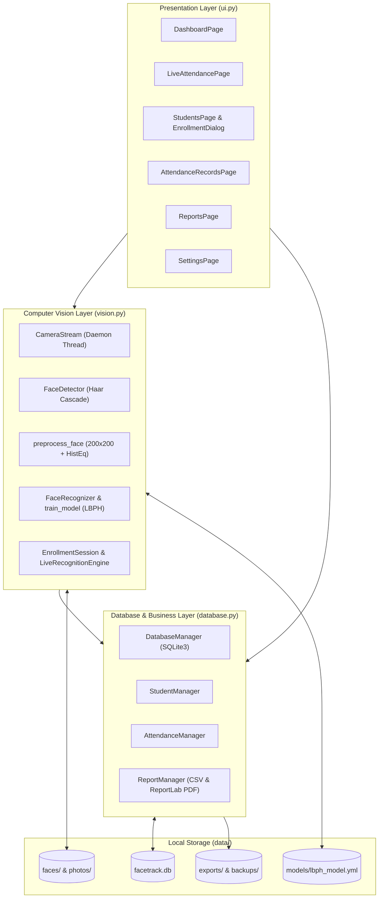

# FaceTrack – Smart Face Recognition Attendance Management System
### Complete Documentation, 5-File Code Reference, 18-Section College Project Report & Professor Viva Guide

---

## Table of Contents

1. [How to Install & Run](#1-how-to-install--run)
2. [Compact 5-File Project Structure](#2-compact-5-file-project-structure)
3. [Step-by-Step Live Demonstration Guide](#3-step-by-step-live-demonstration-guide)
4. [Complete Technical Walkthrough of Every File & Function](#4-complete-technical-walkthrough-of-every-file--function)
   - [4.1 `main.py` — Entry Point & Built-in Test Suite](#41-mainpy--entry-point--built-in-test-suite)
   - [4.2 `config.py` — Paths, Settings, Theme Tokens & Logo Builder](#42-configpy--paths-settings-theme-tokens--logo-builder)
   - [4.3 `database.py` — SQLite Schema, DatabaseManager & Business Managers](#43-databasepy--sqlite-schema-databasemanager--business-managers)
   - [4.4 `vision.py` — Haar Cascade, LBPH Recognizer, Camera Thread & Live Engine](#44-visionpy--haar-cascade-lbph-recognizer-camera-thread--live-engine)
   - [4.5 `ui.py` — CustomTkinter Components, Charts, Dialogs & 6 Pages](#45-uipy--customtkinter-components-charts-dialogs--6-pages)
5. [College Project Report (All 18 Required Sections)](#5-college-project-report-all-18-required-sections)
6. [Professor Viva-Voce Guide: How Every Small Thing Works + 15 Q&As](#6-professor-viva-voce-guide-how-every-small-thing-works--15-qas)

---

## 1. How to Install & Run

Open **PowerShell** or **Command Prompt** in `d:\Face_Recognition`:

```powershell
# 1. Install dependencies (only required once)
pip install -r requirements.txt

# 2. Launch the FaceTrack Desktop Application
python main.py
```

To run the built-in automated test suite (which tests the SQLite schema, regex validation, duplicate attendance prevention, CSV/PDF report generation, database backup/restore, LBPH model training/prediction, and all 6 UI pages):

```powershell
python main.py --test
```

---

## 2. Compact 5-File Project Structure

The entire project is cleanly modularized into **5 Python files** so that each architectural layer lives in its own single file—easy to navigate in your editor and easy to explain during your viva:

```text
d:\Face_Recognition\
├── main.py             # [1] Application entry point (`python main.py`) & test runner (`--test`)
├── config.py           # [2] Paths, constants, default settings, color palette, logger & Pillow logo builder
├── database.py         # [3] SQLite schema + DatabaseManager + StudentManager + AttendanceManager + ReportManager
├── vision.py           # [4] FaceDetector (Haar) + FaceRecognizer (LBPH) + train_model() + CameraStream
│                       #     + EnrollmentSession + LiveRecognitionEngine
├── ui.py               # [5] CustomTkinter widgets + Matplotlib charts + VideoView + Dialogs + 6 Pages + App
├── requirements.txt    # Pinned Python dependencies
├── README.md           # This all-in-one manual, technical reference, 18-section report & viva guide
└── data/               # Auto-created runtime storage:
    ├── facetrack.db    #   SQLite relational database
    ├── faces/          #   200x200 grayscale face samples (`data/faces/<student_pk>/01.png` ... `15.png`)
    ├── photos/         #   Student profile photographs (`data/photos/<student_pk>.jpg`)
    ├── models/         #   Trained LBPH model (`lbph_model.yml` + `labels.json`)
    ├── exports/        #   Generated CSV and PDF reports
    ├── backups/        #   Timestamped SQLite backups
    └── logs/           #   Rotating application log (`facetrack.log`)
```

---

## 3. Step-by-Step Live Demonstration Guide

Follow this exact sequence when demonstrating the project to your professor or examiner:

### Step 1: Launch & Show the Dashboard
1. Run `python main.py`.
2. Point out the **Fixed Left Sidebar** (Dashboard, Live Attendance, Students, Attendance Records, Reports & Analytics, Settings, and the live model status indicator at the bottom).
3. Point out the **Top Header** with the page title and real-time date and ticking clock.
4. On the **Dashboard**, highlight the 4 live database-backed statistic cards (**Registered Students**, **Present Today**, **Absent Today**, **Attendance Rate**), the **7-Day Attendance Trend** bar chart, the **Present vs. Absent** donut chart, **Recent Attendance**, and **Recently Registered Students**.

### Step 2: Register the First Student
1. Click **Students** in the sidebar (or click **Register Student** on the Dashboard).
2. Fill in the registration dialog:
   - **Student ID / Roll No.:** `CS202601` (unique)
   - **Full Name:** Enter your own name (so you can enroll your own face)
   - **Department:** Select `Computer Science` (or type any department)
   - **Course / Class:** `B.Tech CSE`
   - **Email / Phone:** Optional
3. Click **Register Student**.
   - *Tip for Viva:* Mention that `StudentManager.validate()` in `database.py` validates every field with regular expressions and SQLite enforces `UNIQUE` on `student_id`.

### Step 3: Enroll the Student's Face
1. When prompted *"Enroll face now?"*, click **Enroll Now** (or select the student in the table and click **Enroll Face** in the right-hand details panel).
2. Sit 40–70 cm from the webcam in normal room lighting with only yourself in view.
3. Tick the **consent checkbox** (*"The student consents to their face images being captured and stored locally for attendance"*). Notice that the **Start Capture** button stays disabled until consent is given.
4. Click **Start Capture**.
5. Follow the live on-screen pose instructions (*Look straight → Turn slightly left/right → Tilt up/down → Smile*) while **15 usable grayscale `200×200` face samples** are collected.
   - *Tip for Viva:* Point out that `EnrollmentSession` automatically rejects frames with no face, multiple faces, motion blur (Laplacian variance `< 25`), or poor lighting, and spaces captures by `0.35s` so the 15 samples are genuinely diverse.
6. Click **Save & Train Model**.
   - FaceTrack saves the samples to `data/faces/<id>/`, saves the sharpest color crop as the student's profile photo (`data/photos/<id>.jpg`), trains the LBPH model (`data/models/lbph_model.yml`), and updates the sidebar status to **`● Model ready · 1 enrolled`**.

### Step 4: Demonstrate Live Face Recognition Attendance & Duplicate Prevention
1. Click **Live Attendance** in the sidebar and click **Start Camera**.
2. Look at the webcam:
   - First, an **amber box** (`Verifying...`) appears for a fraction of a second while consecutive frames are checked.
   - Once confirmed across **3 consecutive frames** with LBPH distance ≤ threshold (default `50`), the box turns **green** displaying your **Full Name**, **Student ID**, and **LBPH distance**.
   - A toast notification slides in at the bottom-right, the live banner updates, and your check-in immediately appears in **Today's Check-ins**.
3. **Demonstrate Duplicate Prevention:**
   - Keep sitting in front of the webcam. Point out to your examiner that **no second attendance row is created**—the banner shows *"Already Marked Today"* after the cooldown window, and the database strictly enforces one entry per student per day.
4. **Demonstrate Unknown Face Rejection:**
   - Have an unenrolled person look at the camera (or temporarily lower the threshold slider in **Settings** to `30`). The box turns **red** with **`UNKNOWN`** and attendance is never marked.
5. **Demonstrate Controls & Fallback:**
   - Show **Pause Recognition / Resume Recognition**, **Stop Camera**, and **Manual Attendance** (top-right button) for marking attendance when no camera is used.

### Step 5: Demonstrate Attendance Records, Reports & Settings
1. **Attendance Records:** Search by name/ID, filter by date/department/status, toggle *"Include unmarked students as Absent"*, click **Student History** to open a student's complete attendance log, click **Correct / Mark Record** to edit status/time, or click **Export CSV**.
2. **Reports & Analytics:** Switch across all 5 tabs (**Daily Report**, **Weekly Report**, **Monthly Report**, **Student-wise**, **Department-wise**), show the **Attendance Rate Over Time** line chart and **Department Comparison** bar chart, and click **Export CSV** or **Export PDF**.
3. **Settings:** Show the **Webcam Device Index** selector + **Detect Cameras**, the **Recognition Distance Threshold** slider, **Cooldown**, **Confirmation Frames**, **Samples per Enrollment**, **Late Cutoff Time (`HH:MM`)**, **Retrain Face Model Now**, and **Backup / Restore Database**.

---

## 4. Complete Technical Walkthrough of Every File & Function

This section explains **every single file** in your workspace so you can open any file in front of your professor and explain what each class and function does.

---

### 4.1 [`main.py`](file:///d:/Face_Recognition/main.py) — Entry Point & Built-in Test Suite

- **`run_app()`**:
  1. Calls `config.ensure_directories()` to create `data/`, `data/faces/`, `data/photos/`, `data/models/`, `data/exports/`, `data/backups/`, and `data/logs/`.
  2. Sets `MPLCONFIGDIR` to `data/.mplcache` so Matplotlib caches fonts locally.
  3. Initializes rotating file logging via `config.setup_logging()`.
  4. Creates `DatabaseManager(config.DB_PATH)`. If SQLite fails to open, displays a clean error box instead of crashing with a traceback.
  5. Instantiates `App(db)` from `ui.py` and starts `app.mainloop()`.
- **`run_tests()`**:
  - Triggered when you run `python main.py --test`.
  - Redirects all data paths to an isolated temporary directory (`tempfile.mkdtemp`) so your real database is never modified during testing.
  - Runs 7 end-to-end test groups (`schema_and_settings`, `student_crud_and_validation`, `attendance_and_duplicates`, `reports_and_exports`, `backup_and_restore`, `vision_and_lbph`, and `ui_smoke`).

---

### 4.2 [`config.py`](file:///d:/Face_Recognition/config.py) — Paths, Settings, Theme Tokens & Logo Builder

- **Directory & File Constants:**
  - `BASE_DIR`: Project root directory (`d:\Face_Recognition`).
  - `DB_PATH`: `data/facetrack.db`
  - `MODEL_PATH`: `data/models/lbph_model.yml`
  - `LABELS_PATH`: `data/models/labels.json`
  - `LOG_PATH`: `data/logs/facetrack.log`
- **Vision Constants:**
  - `FACE_SIZE = (200, 200)`: Every cropped face is standardized to `200×200` pixels.
  - `MIN_FACE_SIZE = (90, 90)`: Minimum face size during live attendance detection.
  - `ENROLL_MIN_FACE_SIZE = (120, 120)`: Minimum face size during enrollment (ensures the student sits close enough for high-detail samples).
- **`DEFAULT_SETTINGS`**:
  - `camera_index`: `"0"`
  - `recognition_threshold`: `"50"` (LBPH Chi-Square distance; lower = stricter)
  - `recognition_cooldown`: `"5"` seconds
  - `face_sample_count`: `"15"` samples per enrollment
  - `confirm_frames`: `"3"` consecutive frames
  - `late_after`: `""` (optional `"HH:MM"` 24-hour cutoff, e.g. `"09:30"`)
- **`COLORS`**:
  - Warm off-white background (`#F6F3EE`), dark navy-charcoal sidebar (`#1F2733`), pure white card surfaces (`#FFFFFF`), muted terracotta accent (`#C2603A`), semantic green/amber/red/blue status colors.
- **`build_logo_image(size)`**:
  - Dynamically draws the terracotta viewfinder + person silhouette logo in memory using Pillow's `ImageDraw` so the app never fails if an external icon file is moved or deleted.

---

### 4.3 [`database.py`](file:///d:/Face_Recognition/database.py) — SQLite Schema, DatabaseManager & Business Managers

`database.py` is divided into **5 clear sections**:

#### Section 1: `SCHEMA_SQL`
Defines the three SQLite tables with `PRAGMA foreign_keys = ON`:
- **`students`**: Stores student demographics, `photo_path`, and `face_enrolled` (`0` or `1`). `student_id` (Roll Number) has a `UNIQUE` constraint.
- **`attendance`**: Stores `student_id` (`FOREIGN KEY REFERENCES students(id) ON DELETE CASCADE`), `attendance_date`, `check_in_time`, `status` (`Present`, `Late`, `Absent`), `recognition_method` (`Face`, `Manual`), and `confidence` (LBPH distance). Crucially, it enforces **`UNIQUE (student_id, attendance_date)`**.
- **`settings`**: Key-value store (`setting_key PRIMARY KEY`, `setting_value`).

#### Section 2: `DatabaseManager`
- **`connect()`**: Context manager (`with self.connect() as conn:`) that opens a SQLite connection with a 10-second timeout, enables `sqlite3.Row` dictionary-style access and `PRAGMA foreign_keys = ON`, commits on success, rolls back on exception, and closes the connection. Opening a short-lived connection per operation makes it 100% thread-safe between the Tkinter UI thread and the background camera worker thread.
- **`fetch_all(sql, params)`, `fetch_one(sql, params)`, `execute(sql, params)`**: Execute parameterized SQL queries using `?` placeholders (preventing SQL injection).
- **`get_setting()`, `get_setting_int()`, `set_setting()`**: Read and update persistent settings using `INSERT ... ON CONFLICT(setting_key) DO UPDATE`.
- **`backup()`**: Uses SQLite's online backup API (`src.backup(dst)`) to save a consistent snapshot to `data/backups/facetrack_backup_YYYYMMDD_HHMMSS.db`.
- **`restore(backup_file)`**:
  1. Opens the selected file in read-only mode (`mode=ro`).
  2. Verifies that `students`, `attendance`, and `settings` tables exist and that `PRAGMA integrity_check` returns `"ok"`.
  3. Automatically creates a safety backup of the current database before copying the backup over the live database.

#### Section 3: `StudentManager`
- **`validate(data)`**: Validates Roll ID (`^[A-Za-z0-9][A-Za-z0-9\-_/]{0,29}$`), Full Name (letters/spaces, min 2 chars), Department, Course, optional Email (`^[^@\s]+@[^@\s]+\.[A-Za-z]{2,}$`), and optional Phone (`^\+?[0-9][0-9\s\-]{6,18}$`).
- **`add(data)` & `update(pk, data)`**: Insert or update student rows; catches `sqlite3.IntegrityError` to show a friendly error if a duplicate Roll ID is entered.
- **`delete(pk)`**: Deletes the student row (cascading to `attendance`), removes `data/faces/<pk>/` and `data/photos/<pk>.jpg`, and returns `True` if the LBPH model needs retraining.

#### Section 4: `AttendanceManager`
- **`_auto_status(check_in)`**: Checks if `late_after` (e.g., `09:30`) is set in Settings; if `check_in > late_after`, returns `"Late"`, else `"Present"`.
- **`mark(student_pk, method, confidence, status, day, check_in)`**:
  1. Checks `get_record(student_pk, day)` first; if already present, returns `MarkResult("duplicate", ...)`.
  2. Inserts the attendance row; catches `sqlite3.IntegrityError` as a second database-level guard.
- **`list_records(...)`**: Supports filtering by search text, `date_from`, `date_to`, `department`, `status`, and `student_pk`. When `include_unmarked=True` and a single day is selected (`date_from == date_to`), it also queries registered students who have no attendance row on that date and displays them as `Absent (Not marked)`.
- **`export_csv(rows, path)`**: Writes UTF-8 with BOM (`utf-8-sig`) so Microsoft Excel opens the CSV with proper formatting.

#### Section 5: `ReportManager`
- **`daily()`, `weekly()`, `monthly()`, `student_wise()`, `department_wise()`, `overall()`**: Compute real attendance statistics across any date range and department filter.
- **`export_csv()` & `export_pdf()`**: Exports any report tab to CSV, or builds a multi-section A4 PDF report using **ReportLab** complete with a summary table, an embedded Matplotlib attendance trend chart, daily breakdown, department comparison, and student-wise percentages.

---

### 4.4 [`vision.py`](file:///d:/Face_Recognition/vision.py) — Haar Cascade, LBPH Recognizer, Camera Thread & Live Engine

`vision.py` contains the complete computer vision pipeline in **5 sections**:

#### Section 1: `FaceDetector` & Preprocessing
- **`FaceDetector.__init__()`**: Loads `haarcascade_frontalface_default.xml` from `cv2.data.haarcascades`.
- **`FaceDetector.detect(gray, min_size)`**: Runs `cv2.equalizeHist(gray)` followed by `cascade.detectMultiScale(scaleFactor=1.15, minNeighbors=6, minSize=min_size)` and sorts detected faces largest-first.
- **`preprocess_face(gray, rect)`**: Crops `gray[y:y+h, x:x+w]`, resizes to `200×200` (`cv2.INTER_AREA`), and applies `cv2.equalizeHist()`. Used identically during both enrollment and live recognition.
- **`sharpness(img)`**: Computes `cv2.Laplacian(img, cv2.CV_64F).var()` to detect blurry frames.
- **`draw_face_box(frame, rect, color, title, subtitle)`**: Draws a bounding box with thick corner viewfinder brackets and a contrasting title/subtitle banner.

#### Section 2: `FaceRecognizer` & `train_model(db)`
- **`create_lbph()`**: Calls `cv2.face.LBPHFaceRecognizer_create(radius=1, neighbors=8, grid_x=8, grid_y=8)`.
- **`FaceRecognizer`**: Thread-safe wrapper using `threading.Lock()`. `load()` reads `lbph_model.yml` and `labels.json`; `predict(face)` returns `(label, chi_square_distance)`.
- **`train_model(db)`**: Loads all `200×200` grayscale PNG samples for students with `face_enrolled = 1`, trains LBPH using `students.id` as the integer label, writes to `lbph_model.tmp.yml`, and atomically swaps it into `lbph_model.yml` (`tmp.replace(config.MODEL_PATH)`).

#### Section 3: `CameraStream`
- **`open_camera(index)`**: On Windows, tries `cv2.CAP_DSHOW` (DirectShow, fast initialization), then `cv2.CAP_MSMF`, then `cv2.CAP_ANY` at `640×480`.
- **`CameraStream`**: Spawns a daemon thread (`_run`) that reads frames, mirrors them horizontally (`cv2.flip(frame, 1)`), passes each frame through `self.processor(frame)`, calculates live FPS, and stores the latest frame under `self._lock`. Calling `stop()` signals `self._stop` and releases the camera cleanly.

#### Section 4: `EnrollmentSession`
- Checks every frame during enrollment:
  1. `len(faces) == 0` → warns *"No face detected"*.
  2. `len(faces) > 1` → draws red boxes and warns *"Multiple faces detected"*.
  3. `sharpness < 25.0` → warns *"Image is blurry – hold still"*.
  4. `brightness < 45` or `> 215` → warns *"Too dark"* / *"Too bright"*.
  5. Captures one sample every `0.35s` into `data/faces/_tmp_<id>/` while cycling through 7 head-angle/expression prompts.
- **`commit()`**: Moves the temporary folder into `data/faces/<id>/` and saves the sharpest color portrait to `data/photos/<id>.jpg`. If the user cancels (`discard()`), the temporary folder is deleted and any previous enrollment is untouched.

#### Section 5: `LiveRecognitionEngine`
- For each detected face in a live frame:
  1. Calls `recognizer.predict(preprocess_face(gray, rect))` to get `(label, dist)`.
  2. If `student is None` or `dist > self.threshold`: increments `unknown_in_frame` and draws a **red** box labeled `UNKNOWN`.
  3. Otherwise increments `self._streak[label]`. While `_streak[label] < self.confirm_frames`, draws an **amber** box labeled `Verifying...`.
  4. Once `_streak[label] >= self.confirm_frames`, draws a **green** box with the student's name, ID, and distance, and calls `_on_recognized(student, dist)`.
  5. `_on_recognized()` checks `self._last_event[student_id]` against `self.cooldown`, calls `self.attendance.mark()`, and puts the event into `self.events` (`queue.Queue`) for the UI thread.

---

### 4.5 [`ui.py`](file:///d:/Face_Recognition/ui.py) — CustomTkinter Components, Charts, Dialogs & 6 Pages

- **Section 1 (Components):** `Button` (with Segoe Fluent Icons rendered via Pillow), `Card`, `SectionHeader`, `StatCard`, `Badge`, `DataTable` (styled `ttk.Treeview` with column sorting and alternating row colors), `Toast` (slide-in notifications), `Dialog`, and `MessageDialog`.
- **Section 2 (Charts & Video):** `Chart` (`bar_trend`, `line_trend`, `donut`, `hbar` embedded via `FigureCanvasTkAgg`) and `VideoView` (aspect-ratio-preserving webcam canvas with status placeholders).
- **Section 3 (Modal Dialogs):** `StudentFormDialog`, `EnrollmentDialog`, `ManualAttendanceDialog`, `EditAttendanceDialog`, and `StudentHistoryDialog`.
- **Section 4 (The 6 Pages):** `DashboardPage`, `LiveAttendancePage`, `StudentsPage`, `AttendanceRecordsPage`, `ReportsPage`, and `SettingsPage`.
- **Section 5 (`App` Main Window):** Manages sidebar navigation, header clock, `run_in_background()` worker helper, `retrain_model()`, and calls `old_page.on_hide()` whenever switching pages so the webcam is always released when leaving `LiveAttendancePage`.

---

## 5. College Project Report (All 18 Required Sections)

### 5.1 Abstract
Attendance management is a vital administrative process in universities and colleges. Traditional manual roll calls and paper attendance sheets consume instructional time, allow proxy attendance, and require error-prone manual spreadsheet entry. **FaceTrack – Smart Face Recognition Attendance Management System** is a standalone, offline Windows desktop application developed in Python that automates student attendance using computer vision. The system employs **OpenCV's Viola–Jones Haar Cascade Classifier** for real-time frontal face detection and the **Local Binary Patterns Histograms (LBPH)** algorithm (`cv2.face.LBPHFaceRecognizer`) for facial recognition. When an enrolled student is recognized across consecutive frames within a configurable Chi-Square distance threshold, attendance is automatically recorded in a local **SQLite** relational database enforcing a `UNIQUE(student_id, attendance_date)` constraint. Built with **CustomTkinter**, **Matplotlib**, and **ReportLab**, FaceTrack integrates student management, guided face enrollment with blur and illumination checks, live camera attendance, manual fallback, searchable records, and CSV/PDF analytics reports.

### 5.2 Introduction
In higher education, tracking daily attendance is essential for academic compliance and student engagement. As class sizes expand, calling roll numbers manually becomes inefficient. Biometric face recognition using a standard classroom or laptop webcam provides a contactless, fast, and verifiable solution without requiring specialized fingerprint readers or RFID cards.

### 5.3 Problem Definition
1. **Loss of Lecture Time:** Manual roll calls take 5–10 minutes per session.
2. **Proxy Attendance:** Students can easily sign paper sheets or answer roll calls for absent peers.
3. **Delayed Reporting:** Paper registers must be manually typed into spreadsheets to compute monthly attendance percentages.
4. **Cloud & Build Dependencies:** Many face recognition libraries require paid cloud APIs, internet access, or heavy C++/GPU toolchains (`dlib`), making them impractical for standard college computers.

### 5.4 Existing System
- **Paper Registers / Verbal Roll Call:** Slow, error-prone, no automatic analytics.
- **RFID Smart Cards:** Vulnerable to buddy-swiping when a student hands their card to a classmate.
- **Fingerprint Scanners:** Require dedicated hardware, physical contact, and slow single-file queues.
- **Cloud Vision APIs:** Require continuous internet connectivity, recurring API fees, and upload student biometrics to external servers.

### 5.5 Proposed System
**FaceTrack** introduces an offline, self-contained desktop system featuring:
- Real-time multi-face detection and recognition at ~25–30 FPS on standard laptop CPUs.
- Guided 15-sample face enrollment with automatic blur, brightness, and single-face quality checks plus explicit student consent.
- Three-layer duplicate prevention (consecutive frame confirmation, notification cooldown, and SQLite `UNIQUE(student_id, attendance_date)` constraint).
- Built-in dashboard charts, date-range reports (Daily, Weekly, Monthly, Student-wise, Department-wise), and one-click CSV and PDF exports.

### 5.6 System Architecture


### 5.7 Software and Hardware Requirements
- **Hardware Requirements:**
  - Processor: Intel Core i3 / AMD Ryzen 3 or higher
  - RAM: 4 GB minimum (8 GB recommended)
  - Storage: 250 MB free disk space
  - Webcam: Built-in 720p laptop camera or USB webcam
  - Display: 1366×768 resolution or higher
- **Software Requirements:**
  - Operating System: Windows 10 / 11 (64-bit)
  - Language: Python 3.12
  - Packages: `opencv-contrib-python==4.10.0.84`, `customtkinter==5.2.2`, `Pillow>=10.0.0`, `matplotlib>=3.8.0`, `numpy>=1.26.0`, `reportlab>=4.0.0`, `pandas>=2.0.0`

### 5.8 Methodology
1. **Registration Phase:** Student details are validated via regex and stored in the `students` table.
2. **Enrollment & Training Phase:** The webcam captures 15 sharp, well-lit grayscale `200×200` face samples across varied expressions/angles. `train_model()` computes spatial LBP histograms and saves `lbph_model.yml`.
3. **Live Recognition Phase:** Each webcam frame is scanned by the Haar Cascade detector, normalized to `200×200` with histogram equalization, and classified by LBPH. Matches within the distance threshold across 3 consecutive frames are logged in `attendance`.
4. **Reporting Phase:** SQL queries aggregate session-day attendance rates across custom date ranges and export CSV/PDF reports.

### 5.9 Computer Vision Concepts Used
1. **Grayscale Conversion:** Reduces 3-channel BGR images to single-channel intensity arrays for 3× faster processing.
2. **Histogram Equalization (`cv2.equalizeHist`):** Normalizes image contrast across the `0–255` range to reduce lighting sensitivity.
3. **Laplacian Edge Variance (`cv2.Laplacian`):** Computes the variance of second derivatives to reject motion-blurred enrollment frames.
4. **Image Pyramid Scaling (`scaleFactor=1.15`):** Enables scale-invariant face detection at different distances from the camera.

### 5.10 Face Detection Explanation (Viola–Jones Haar Cascade)
The Viola–Jones detector identifies faces using:
1. **Haar-like Rectangular Features:** Evaluates intensity differences between adjacent rectangular regions (such as darker eye sockets relative to the nose bridge and cheeks).
2. **Integral Image:** Precomputes cumulative pixel sums so any rectangular region sum is evaluated in $O(1)$ time with 4 array lookups.
3. **AdaBoost Learning:** Selects the most informative Haar features.
4. **Cascade Classifier:** Chains stages of increasing complexity so non-face background regions are discarded in the earliest stages, enabling real-time CPU execution.

### 5.11 LBPH Face Recognition Explanation
The **Local Binary Patterns Histograms (LBPH)** algorithm recognizes faces through four steps:
1. **Local Binary Pattern (LBP) Coding:** For each pixel with intensity $g_c$, its 8 neighbors $g_0, \dots, g_7$ on radius $R=1$ are thresholded:
   $$\text{LBP}(x_c, y_c) = \sum_{p=0}^{7} s(g_p - g_c) \, 2^p, \qquad s(z) = \begin{cases} 1 & z \ge 0 \\ 0 & z < 0 \end{cases}$$
   This produces an 8-bit number (`0–255`) describing local micro-texture (edges, spots, corners) invariant to uniform illumination changes.
2. **Spatial Grid Division (`8×8`):** The `200×200` LBP image is divided into $8 \times 8 = 64$ sub-regions to preserve facial geometry.
3. **Regional Histogram Concatenation:** A 256-bin histogram is computed for each of the 64 regions and concatenated into a 16,384-dimensional feature vector.
4. **Chi-Square ($\chi^2$) Nearest-Neighbor Classification:** A query face histogram $S$ is compared with stored training histograms $M$:
   $$D(S, M) = \sum_{i} \frac{(S_i - M_i)^2}{S_i + M_i}$$
   Lower $D$ indicates higher similarity. If $D \le \text{threshold}$, the identity is accepted; otherwise the face is classified as **UNKNOWN**.

### 5.12 Database Design
- **`students`**: `id` (`INTEGER PK AUTOINCREMENT`), `student_id` (`TEXT UNIQUE NOT NULL`), `full_name` (`TEXT NOT NULL`), `department` (`TEXT NOT NULL`), `course` (`TEXT NOT NULL`), `email` (`TEXT`), `phone` (`TEXT`), `photo_path` (`TEXT`), `face_enrolled` (`INTEGER DEFAULT 0`), `created_at` (`TEXT`).
- **`attendance`**: `id` (`INTEGER PK AUTOINCREMENT`), `student_id` (`INTEGER FK -> students.id ON DELETE CASCADE`), `attendance_date` (`TEXT NOT NULL`), `check_in_time` (`TEXT`), `status` (`TEXT CHECK('Present','Late','Absent')`), `recognition_method` (`TEXT CHECK('Face','Manual')`), `confidence` (`REAL`), **`UNIQUE(student_id, attendance_date)`**.
- **`settings`**: `setting_key` (`TEXT PK`), `setting_value` (`TEXT`).

### 5.13 Module Descriptions
- **`main.py`**: Entry point and automated test suite runner.
- **`config.py`**: Global paths, vision constants, default settings, color tokens, logging, and Pillow logo builder.
- **`database.py`**: SQLite schema, `DatabaseManager`, `StudentManager`, `AttendanceManager`, and `ReportManager`.
- **`vision.py`**: `FaceDetector`, `FaceRecognizer`, `train_model()`, `CameraStream`, `EnrollmentSession`, and `LiveRecognitionEngine`.
- **`ui.py`**: CustomTkinter widgets, Matplotlib charts, video canvas, modal dialogs, 6 application pages, and `App` window.

### 5.14 Testing
All modules are verified through `python main.py --test`, which runs 7 automated test suites covering database schema creation, settings persistence, student validation & CRUD, two-layer duplicate attendance prevention, CSV & PDF report exports, online SQLite backup & restore rollback, LBPH training & prediction, and a 6-page GUI smoke test.

### 5.15 Advantages
- Works 100% offline with zero cloud costs or privacy leakage.
- Runs smoothly at real-time frame rates on standard college laptops without a GPU.
- Prevents proxy and duplicate daily attendance automatically.
- Includes full manual fallback, record correction, and database backup/restore.

### 5.16 Limitations
- Frontal Haar Cascade requires the face to be within roughly ±25° head rotation.
- Extreme backlighting can increase LBPH distance scores.
- Standard 2D RGB webcams do not provide hardware depth-based spoof detection.

### 5.17 Future Scope
- Eye-blink / head-turn active liveness verification.
- Multi-period / subject-wise timetable attendance within the same day.
- Automated email/SMS shortage notifications for students below 75% attendance.

### 5.18 Conclusion
**FaceTrack** successfully integrates classical computer vision (Haar Cascades and LBPH), relational database engineering (SQLite), and modern desktop UI design (CustomTkinter) into a reliable, maintainable, and practical attendance management system ready for classroom use.

---

## 6. Professor Viva-Voce Guide: How Every Small Thing Works + 15 Q&As

### How to Explain the 60-Second Overview to Your Professor
> *"Professor, my project is **FaceTrack**, an offline desktop attendance management system in Python. We structured it cleanly into 5 modules: `main.py` (entry point), `config.py` (settings & theme), `database.py` (SQLite schema and business managers), `vision.py` (Haar Cascade detection, LBPH recognition, and background webcam threads), and `ui.py` (CustomTkinter interface and Matplotlib charts). When a student registers, we capture 15 quality-checked `200×200` grayscale face samples and train an OpenCV LBPH model. During live attendance, faces are detected by Haar Cascade, recognized by LBPH Chi-Square histogram distance across 3 consecutive frames, and saved to SQLite with a `UNIQUE(student_id, attendance_date)` constraint so a student is marked once per day."*

---

### 15 Most Likely Professor Viva Questions & Exact Answers

1. **Q: Why did you organize the code into 5 files (`main.py`, `config.py`, `database.py`, `vision.py`, `ui.py`)?**
   - **A:** It follows **Separation of Concerns (3-Tier Architecture)**: `ui.py` is the Presentation Layer, `vision.py` is the Computer Vision Layer, `database.py` is the Data & Business Logic Layer, `config.py` holds shared configuration, and `main.py` is the entry point. Every layer is isolated in its own single file without scattering code across dozens of tiny files.

2. **Q: Why did you install `opencv-contrib-python` instead of `opencv-python`?**
   - **A:** `opencv-python` only contains core OpenCV modules. The `cv2.face` module—which provides `LBPHFaceRecognizer_create()`—is part of OpenCV's `opencv_contrib` repository, which is packaged in `opencv-contrib-python`.

3. **Q: What is the difference between Face Detection and Face Recognition in your project?**
   - **A:** **Face Detection** (using the Viola–Jones Haar Cascade in `FaceDetector.detect`) finds *where* any human face is in the frame and returns its bounding box `(x, y, w, h)`. **Face Recognition** (using LBPH in `FaceRecognizer.predict`) takes that cropped `200×200` face and determines *whose* face it is by matching its LBP texture histograms against enrolled students.

4. **Q: What do the parameters `scaleFactor=1.15`, `minNeighbors=6`, and `minSize` in `detectMultiScale` mean?**
   - **A:**
     - `scaleFactor=1.15`: Shrinks the image by 15% at each level of the image pyramid so the fixed-size Haar window can detect both close (large) and far (small) faces.
     - `minNeighbors=6`: Requires at least 6 overlapping positive detection rectangles around a face before confirming it, which eliminates false positives in the background.
     - `minSize`: Ignores regions smaller than `90×90` px (live) or `120×120` px (enrollment).

5. **Q: Why do you apply `cv2.equalizeHist()` twice—once before detection and once in `preprocess_face()`?**
   - **A:** Before detection, `equalizeHist` normalizes whole-frame contrast so Haar Cascade can find faces even in dim rooms. Inside `preprocess_face()`, applying `equalizeHist` specifically on the cropped `200×200` face ensures the facial region itself has normalized lighting before LBPH histograms are computed.

6. **Q: How does `sharpness()` detect if a frame is blurry during face enrollment?**
   - **A:** It computes `cv2.Laplacian(img, cv2.CV_64F).var()`—the variance of the image's Laplacian (second spatial derivative). A sharp, focused face has strong edges and high variance (`≥ 25.0`), whereas motion blur smooths out edges and produces low variance (`< 25.0`), which our enrollment session automatically skips.

7. **Q: In `LBPHFaceRecognizer_create(radius=1, neighbors=8, grid_x=8, grid_y=8)`, what do those 4 parameters mean?**
   - **A:**
     - `radius=1` and `neighbors=8`: For every pixel, compare it with its 8 immediate neighbors on a 1-pixel radius circle to form an 8-bit binary number (`0–255`).
     - `grid_x=8` and `grid_y=8`: Divide the `200×200` face into $8 \times 8 = 64$ cells and build a 256-bin histogram in each cell so spatial facial structure (eyes, nose, mouth positions) is preserved.

8. **Q: What does the `distance` (or `confidence`) value returned by `LBPH.predict(face)` represent?**
   - **A:** It is the **Chi-Square ($\chi^2$) distance** between the live face's histogram and the closest training histogram: $D(S,M) = \sum \frac{(S_i - M_i)^2}{S_i + M_i}$. Because it is a distance metric, **`0` is a perfect match, lower numbers mean higher similarity**, and numbers above our threshold (`50`) are rejected as **UNKNOWN**.

9. **Q: How does `train_model()` avoid corrupting `lbph_model.yml` if the app closes mid-training?**
   - **A:** It writes the trained model to a temporary file `lbph_model.tmp.yml` first and then performs an atomic filesystem rename `tmp.replace(config.MODEL_PATH)` so `lbph_model.yml` is never left half-written.

10. **Q: How do you prevent duplicate attendance if a student remains in front of the camera?**
    - **A:** Through three mechanisms:
      1. **Consecutive frame confirmation (`confirm_frames=3`):** Requires 3 consecutive matching frames before triggering.
      2. **Cooldown timer (`recognition_cooldown=5s`):** Suppresses repeated triggers for that student during the cooldown window.
      3. **Database uniqueness:** `AttendanceManager.mark()` checks `get_record(student_pk, today)` before inserting, and SQLite enforces `UNIQUE (student_id, attendance_date)` on the `attendance` table.

11. **Q: How do you prevent the Tkinter window from freezing while the webcam is running?**
    - **A:** `CameraStream` in `vision.py` runs `cv2.VideoCapture.read()` and face detection/recognition on a background daemon thread (`threading.Thread(daemon=True)`). The UI thread never blocks on camera I/O; it simply polls `stream.get_frame()` every 30 milliseconds via `self.after(30, self._poll)`.

12. **Q: Why is it unsafe to update Tkinter labels directly from the camera thread, and how did you solve it?**
    - **A:** Tkinter (`tcl/tk`) is not thread-safe. In `vision.py`, `LiveRecognitionEngine` pushes attendance events into a thread-safe `queue.Queue()` (`self.events.put(...)`), and `LiveAttendancePage._poll()` drains that queue on the main UI thread.

13. **Q: What happens when you switch away from the Live Attendance tab while the camera is running?**
    - **A:** In `ui.py`, `App.show_page()` calls `old_page.on_hide()` before switching tabs. `LiveAttendancePage.on_hide()` calls `self.stop_camera()`, which stops the `CameraStream` thread and calls `cap.release()` so the webcam hardware is released immediately.

14. **Q: How do you prevent SQL injection in `database.py`?**
    - **A:** Every SQL statement in `database.py` uses parameterized queries with `?` placeholders (`conn.execute(sql, tuple(params))`) rather than Python string concatenation or f-strings.

15. **Q: What happens in the database when a student is deleted?**
    - **A:** Because `attendance.student_id` has `FOREIGN KEY (student_id) REFERENCES students(id) ON DELETE CASCADE` and `PRAGMA foreign_keys = ON` is enabled on every connection, deleting a student from `students` automatically deletes their attendance rows, deletes their `data/faces/<id>/` folder and photo, and retrains the LBPH model.
